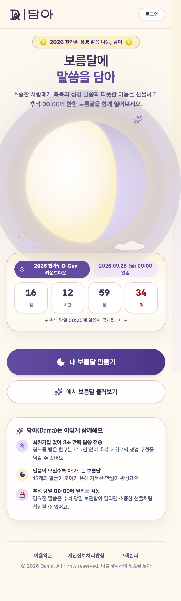
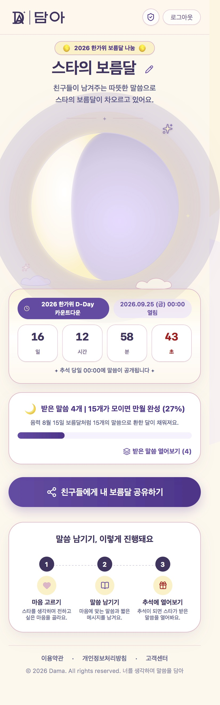
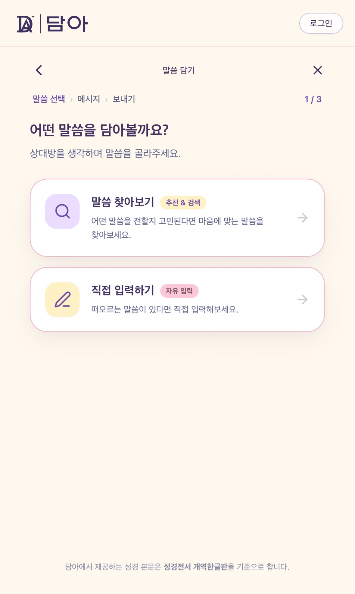
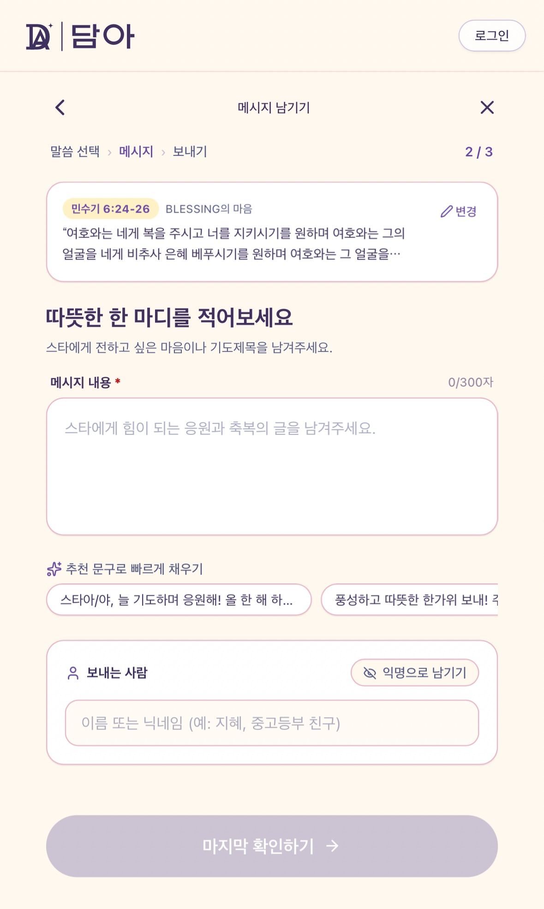
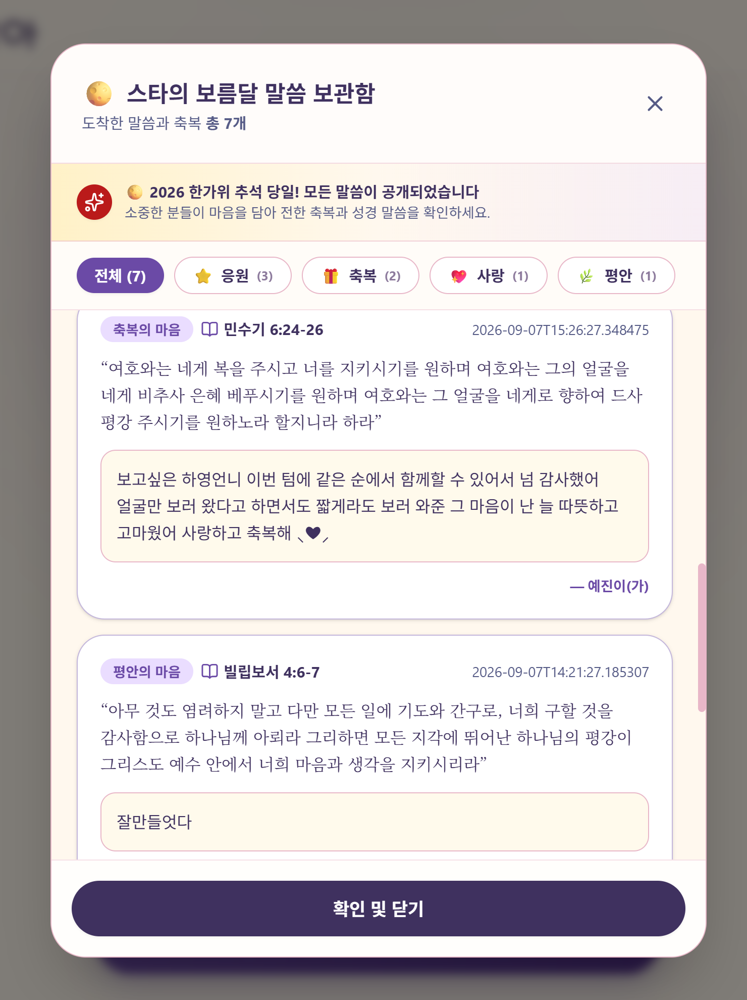

# Dama 🌕

> 추석날 보름달과 함께 공개되는 메시지 서비스

Dama는 추석 전에 소중한 사람에게 마음을 담은 메시지를 남기고,  
추석 당일 보름달과 함께 메시지를 확인할 수 있는 웹 서비스입니다.

사용자는 자신의 보름달을 생성해 친구에게 공유할 수 있으며,  
공유받은 친구는 말씀과 메시지를 보름달에 담을 수 있습니다.

<br>

## ✨ 주요 기능

- 카카오 OAuth 로그인
- 닉네임 설정
- 나만의 보름달 생성
- 보름달 공유 링크 제공
- 공유받은 보름달에 메시지 작성
- 카테고리별 말씀 선택 또는 직접 작성
- 작성한 메시지 최종 확인 및 전송
- 추석 공개 시점에 따른 메시지 공개
- 보름달에 담긴 메시지 수에 따른 달 채움 표현

<br>

## 🖥 주요 화면


### Landing

서비스 소개와 추석까지 남은 시간을 확인할 수 있습니다.

### Moon

사용자가 생성한 보름달과 현재까지 담긴 메시지를 확인할 수 있습니다.

### Share Moon

공유 링크를 통해 다른 사용자의 보름달에 접속할 수 있습니다.



### Leave Message

말씀을 선택하거나 직접 작성한 뒤 개인 메시지를 함께 담을 수 있습니다.

### Confirm Message

작성한 말씀과 메시지를 최종 확인한 뒤 보름달에 전송할 수 있습니다.

<br>

## 🛠 Tech Stack

### Frontend

- React 19
- Vite
- JavaScript
- React Router
- Tailwind CSS
- Motion
- Lucide React

### Deployment

- AWS S3
- AWS CloudFront
- GitHub Actions
- GitHub OIDC

<br>

## 📁 Project Structure

```text
src/
├── assets/              # 이미지 등 정적 리소스
│
├── components/          # 공통 UI 컴포넌트
│   ├── ChuseokCountdown.jsx
│   ├── CreateMoonModal.jsx
│   ├── DamaLogo.jsx
│   ├── Header.jsx
│   ├── HeroMoonSection.jsx
│   ├── LoginModal.jsx
│   ├── MoonVisual.jsx
│   ├── NicknameModal.jsx
│   └── ViewVersesModal.jsx
│
├── config/
│   └── api.js           # API 및 서비스 URL 설정
│
├── constants/
│   └── chuseok.js       # 추석 관련 상수
│
├── data/
│   └── verses.js        # 말씀 데이터
│
├── features/
│   └── leaveVerse/      # 말씀 및 메시지 작성 기능
│       ├── Step1ChooseVerseMethod.jsx
│       ├── Step1SelectVerse.jsx
│       ├── Step1WriteVerse.jsx
│       ├── Step2WriteMessage.jsx
│       └── Step3ConfirmSend.jsx
│
├── hooks/
│   └── useChuseokPeriod.js
│
├── pages/
│   ├── FriendMoonPage.jsx
│   ├── LandingPage.jsx
│   ├── LoginPage.jsx
│   ├── MoonPage.jsx
│   ├── PrivacyPage.jsx
│   ├── SupportPage.jsx
│   └── TermsPage.jsx
│
├── utils/
│   └── shareMessages.js
│
├── App.jsx              # 라우팅 및 전역 상태 관리
├── index.css
└── main.jsx             # 애플리케이션 진입점
```

<br>

## 🔀 주요 Routes

```text
/                       랜딩 페이지
/login                  로그인
/moon/:moonId           내 보름달
/share/:shareToken      공유받은 보름달
/support                고객지원
/terms                  이용약관
/privacy                개인정보처리방침
```

<br>

## 🚀 CI/CD

`main` 브랜치에 코드가 Push되면 GitHub Actions를 통해 자동으로 빌드 및 배포됩니다.

```text
GitHub
   │
   ▼
GitHub Actions
   │
   ├── npm ci
   │
   ├── Vite Build
   │
   ▼
GitHub OIDC
   │
   ▼
AWS IAM Role
   │
   ▼
AWS S3
   │
   ▼
CloudFront Cache Invalidation
   │
   ▼
User
```

Pull Request에서는 빌드 검증만 수행하고,  
`main` 브랜치에 Push된 경우에만 실제 AWS 배포를 진행합니다.

AWS 인증은 Access Key를 직접 저장하는 방식이 아니라  
GitHub OIDC를 이용해 AWS IAM Role을 Assume하는 방식으로 구성했습니다.

<br>

## ⚙️ Environment Variables

로컬 개발을 위해 다음 환경변수가 필요합니다.

```env
VITE_API_BASE_URL=http://localhost:8080
VITE_PUBLIC_APP_URL=http://localhost:5173
```

`.env.example` 파일을 참고해 환경에 맞게 설정할 수 있습니다.

<br>

## 💻 Local Development

```bash
npm install
npm run dev
```

기본 개발 서버는 다음 주소에서 실행됩니다.

```text
http://localhost:5173
```
